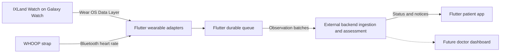

# IXLand post-discharge monitoring

The current implementation includes placeholder sign-in, the bundled provider picker, and WHOOP and Galaxy Watch heart-rate adapters that share an in-memory batch buffer. See [the mobile implementation record](mobile-implementation.md) for the delivered flow. The sections below describe the intended system.

## Product flow

1. The patient signs into the Flutter app and opens the recovery episode assigned by the backend. The app explains which wearable data will be shared and lets the patient link a WHOOP or a Samsung Galaxy Watch.
2. The app reads available observations, saves them in a local queue, and sends POST requests on a configurable minute interval. Each request contains one measurement window. The app shows the wearable connection, latest measurement time, and last successful upload. See the [backend contract](contracts.md#wearable-metric-upload).
3. The backend processes the observations and returns a recovery status and any associated notices. The patient sees the latest status, when it was assessed, and any next step supplied by the care team through the backend. A completed sleep session sent with a batch gives the backend the time window for calculating HRV from beat-to-beat intervals.
4. A future doctor web app presents an overview of assigned patients, surfaces reported complications for review, and distinguishes cases with missing or stale data. It will consume the backend's assessments. Its design and implementation follow the mobile work.

The **Flutter patient app** is the current delivery scope. The external backend developer owns patient enrollment and episode identity, authentication, storage and processing, rule execution, flags, and the data that will later feed the doctor dashboard. Firebase remains the expected backend platform from the initial plan. The Flutter app uses an interface that can accommodate the backend developer's chosen transport.

## Flutter module boundaries

| Module | Owns |
| --- | --- |
| Recovery session | Sign-in, patient session, active recovery episode, and account changes. |
| Wearable connections | A common adapter interface. WHOOP BLE and the Galaxy Watch companion supply live heart rate. Adapters own permissions, discovery, source parsing and provenance, and disconnect. |
| Sync coordinator | Reads pages, builds batches, manages a durable local queue, retries uploads, and reports sync state. |
| Recovery gateway | Maps enrollment, upload, and recovery status to the backend contract. Has a fake for local demos and tests. |
| Patient UI | Onboarding, wearable setup, recovery status, notices, and sync troubleshooting. Renders backend status and local sync health as separate information. |

Widgets depend on view models. Provider APIs and network calls stay behind adapters and repositories. Keep app models independent of Firebase types so the team can test the Flutter flow while the external backend is in development. [Flutter offline-first architecture](https://docs.flutter.dev/app-architecture/design-patterns/offline-first)

## Wearable connections

**Samsung Galaxy Watch.** IXLand Watch uses Wear OS Health Services to read heart rate in the foreground. It sends samples to the paired Android phone through Wear OS Data Layer. The Flutter Samsung adapter uses the same batch buffer as WHOOP. [Samsung Watch4 sensor access](https://developer.samsung.com/health/blog/en/2022/01/14/using-health-services-on-galaxy-watch) · [Wear OS Data Layer](https://developer.android.com/training/wearables/data/overview)

**WHOOP.** The adapter can initiate WHOOP 4.0 pairing over Bluetooth and read live heart rate. It also supports the standard Heart Rate Broadcast path. Both paths timestamp readings on receipt and group them into the shared batch buffer. The planned sleep path downloads stored Bluetooth sensor history and estimates completed sleep windows locally. Verify sleep timing and interval coverage on a physical WHOOP 4.0 before using the results in the backend. [Noop WHOOP 4 profile](https://github.com/ryanbr/noop/blob/main/docs/PROTOCOL_WHOOP4.md) · [Noop sleep detection](https://github.com/ryanbr/noop/blob/main/docs/ANALYTICS.md) · [WHOOP Heart Rate Broadcast](https://www.whoop.com/us/en/thelocker/strain-coach/)

Use a synthetic batch to prove the POST transport and test each provider's metric availability separately. Align metric definitions, units, timing, missing-data behavior, consent, and the recovery episode's collection window with the backend and clinical owners before collecting patient data.

## Sync, freshness, and patient experience

- Start wearable reads on app open, resume, and manual refresh. Schedule uploads of ready batches on the configured cadence while the app can run. Test background sync after measuring the delay from the wearable to the backend. Show the last measurement time, upload time, and assessment time where they help the patient understand freshness. [Android Health Connect sync](https://developer.android.com/health-and-fitness/health-connect/sync-data)
- Keep queued observations and cursors in account- and episode-scoped app-private storage. Agree on at-rest protection, queue lifetime, the behavior on disconnect or sign-out, and how the patient can stop sharing. Clear sensitive on-screen state on sign-out. Keep health details out of lock-screen notifications, logs, and analytics.
- Display a favorable recovery assessment only when the backend explicitly supplies a current assessment with sufficient data. Pending upload, unavailable service, stale readings, and lack of an assessment remain separate states. If an earlier notice remains open, show it as a prior notice with its timestamp and indicate when current status is unavailable.
- The clinical owner and backend developer define thresholds, wording, escalation, and who is responsible for reviewing flags. The Flutter app renders the approved result and any supplied instructions. A patient acknowledgment, if supported later, records receipt and leaves clinical resolution to the care workflow.
